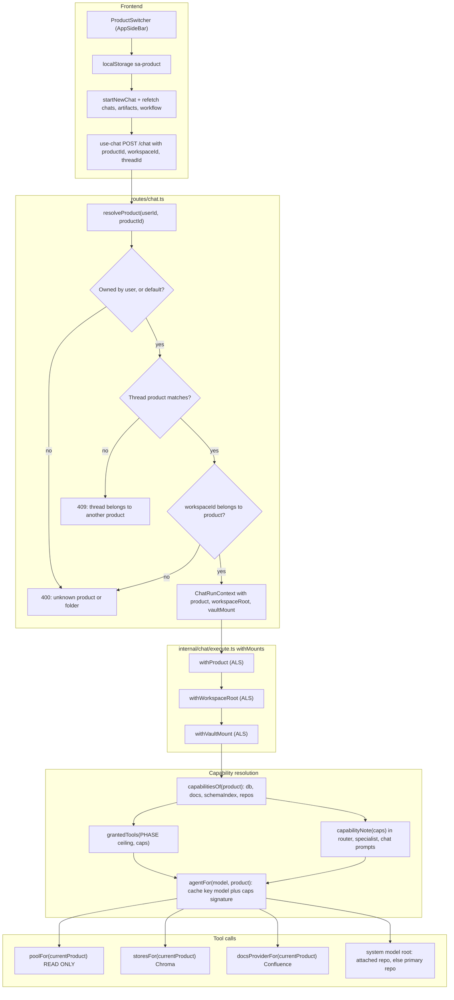
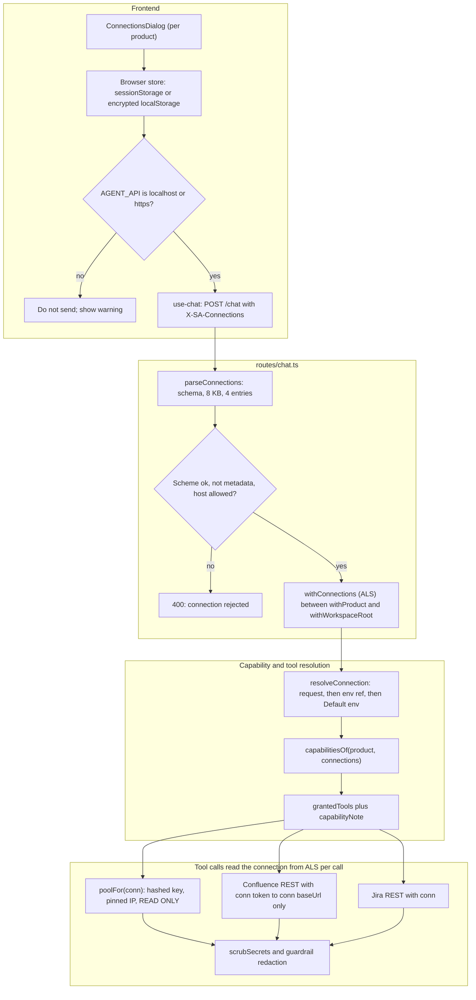

# Multi-product Groundwork

## Overview

A user keeps several products (Aster, Club&co, Groundwork) in one Groundwork workspace and switches between them in one click. A **Product** owns its repos, an optional database, an optional Confluence space, an optional Jira site, its Chroma index collections, and optional model defaults. Credentials for those are entered per product in a Connections modal and kept in the user's browser, or referenced by env-var name for Claude Code and Codex. Every `/chat` request runs inside one active product, resolved through `AsyncLocalStorage` next to the workspace root and vault mount. The agent is only granted the tools that product can back, and its prompts say what is missing instead of failing on it.

Today everything is one global config: `DATABASE_URL`, `CONFLUENCE_*` and `CHROMA_*` in [backend/config.ts](../../backend/config.ts), one `pg` pool in [backend/database/postgres.ts](../../backend/database/postgres.ts), two module-level Chroma stores in [backend/database/chroma.ts](../../backend/database/chroma.ts), and static phase tool lists in [backend/agents/harness.ts](../../backend/agents/harness.ts). This plan replaces those singletons with per-product lookups while keeping an existing `.env` working as an auto-created **Default** product.

Out of scope: multi-user sharing of products, billing, and auto-importing docs into Chroma.

---

## Design decisions

### 1. Product extends workspaces; it does not replace them

**Decision:** Add a `products` table. A `workspaces` row becomes one of a product's **repos** through a new nullable `workspaces.product_id`. A product has zero or more repos; the first-created repo is its **primary repo**.

- The sidebar "Projects" section collapses into the **product switcher** plus the active product's repo list.
- The "Work in a folder" menu in [frontend/components/chat-input.tsx](../../frontend/components/chat-input.tsx) lists only the active product's repos. Picking one still sends `workspaceId`, exactly as today.
- `@Projects/...` mentions resolve only against the active product's repos.

**Alternatives considered:**
- Replace `workspaces` with `products` (rejected: forces a data migration of every row, and breaks `routes/workspaces/*`, mention tokens and `AddFolderDialog` at once).
- Store repos as a `text[]` on `products` (rejected: loses the per-folder id that `/chat` already validates through `getWorkspace`).

### 2. Default product is virtual

**Decision:** The Default product has id `default`, is synthesized at runtime from the existing env (`DATABASE_URL`, `DATABASE_SCHEMA`, `CONFLUENCE_*`, `CHROMA_*`, `AGENT_*_MODEL`), and is **never stored**. Every row with `product_id IS NULL` (workspaces, chat threads, artifacts) belongs to it.

**Why:** Existing setups keep working with zero SQL writes and zero user action. An install that never creates a product behaves exactly as it does today.

### 3. Secrets never reach Supabase; two credential sources

**Decision:** A credential reaches the backend from one of two sources, and neither stores a secret value on a server:

1. **Browser connections** (the default for products created in the GUI): the user enters URL and token per product in the Connections modal, they stay in that browser, and they are sent with each request. See decision 11.
2. **Env references** (the path Claude Code and Codex use): Supabase and `.sa/product.json` store only the **name** of an env var, `db_url_env` (for example `SA_PRODUCT_ASTER_DATABASE_URL`) and an optional Confluence `tokenEnv`. The backend reads the value from `process.env` at request time.

The rules below apply to the env-reference source.

- Names must match `^SA_PRODUCT_[A-Z0-9_]+$`, so a product cannot point `db_url_env` at `SUPABASE_SERVICE_ROLE_KEY`, `BIFROST_API_KEY` or any other backend secret. Default is the only product allowed to use `DATABASE_URL` and `CONFLUENCE_*`.
- Product API responses return `{ db: { configured: true, envVar: "SA_PRODUCT_ASTER_DATABASE_URL", schema } }`: the name and a boolean, never the value.
- No new `NEXT_PUBLIC_` variable carries anything but a public URL.
- Connection-test errors are scrubbed of the connection string before they are returned (pg puts the host in `ENOTFOUND` messages; the password must never appear). Reuse `databaseTarget()` from [backend/scripts/doctor.ts](../../backend/scripts/doctor.ts), which already describes a URL as `host:port/db` without its userinfo and is covered by `doctor.test.ts`.

### 4. Confluence is the only docs source; the RAG pipeline is the product's index

**Decision:** `docs_provider` is `confluence | none`.

- `confluence`: `search_docs` and `get_doc_page` read live pages through the existing MCP path in [backend/agents/tools/core/confluence.ts](../../backend/agents/tools/core/confluence.ts), using the product's `baseUrl`, `spaceKey` and credentials.
- `none`: `search_docs` and `get_doc_page` are not granted.
- The **index** is the RAG pipeline: per-product Chroma collections (`apiSpecCollection`, `ddlCollection`) filled from Confluence and DDL by the existing `ingest:confluence`, `ingest:ddl` and `ingest:url` scripts. `search_schema_docs` is granted when the product's `ddlCollection` is set.
- A small `DocsProvider` interface (`search`, `fetch`, `test`) keeps `knowledge.ts` provider-agnostic, but only the Confluence implementation ships.

**Credential model:** Every product has its own Confluence credentials; there is never a login shared across products. A Confluence connection is `{ baseUrl, spaceKey, username?, token? }`, entered as one unit (decision 11).

- **The token is optional.** Some products' Confluence spaces are readable without one. In that case the provider sends no `Authorization` header, and the connection test reports "anonymous access" rather than failing.
- Setting up Confluence at all is optional per product. A product without it simply has no `docs` capability.
- The backend never pairs a token with a URL it did not arrive with:
  - a browser connection's token is only sent to that connection's `baseUrl`;
  - an env-sourced token (the product's own `tokenEnv`) is only sent to that product's configured origin.
- Default keeps today's `CONFLUENCE_*` pair from `.env`, and no other product can use it.

This replaces the earlier `CONFLUENCE_ALLOWED_ORIGINS` rule.

### 5. Active-product context through AsyncLocalStorage

**Decision:** New `backend/internal/product/runtime.ts` mirrors [backend/internal/workspace/runtime.ts](../../backend/internal/workspace/runtime.ts):

```ts
const store = new AsyncLocalStorage<ResolvedProduct>();
export function currentProduct(): ResolvedProduct { return store.getStore() ?? defaultProduct(); }
export function withProduct<T>(product: ResolvedProduct, fn: () => Promise<T>): Promise<T> {
  return store.run(product, fn);
}
```

`withMounts` in [backend/internal/chat/execute.ts](../../backend/internal/chat/execute.ts) wraps it outermost:

```ts
withLlmSession(run.threadId, () =>
  withProduct(run.product, () =>
    withWorkspaceRoot(run.workspaceRoot, () =>
      withVaultMount(run.vaultMount, fn))));
```

`productId` is also added to LangGraph `configurable` and to `ToolContext` in [backend/agents/tools/catalog/types.ts](../../backend/agents/tools/catalog/types.ts), the same dual path `workspaceRoot` uses. `currentProduct()` falls back to Default, so scripts and tests that never call `withProduct` keep today's behaviour.

### 6. Per-product resources replace the singletons

| Today | After |
|---|---|
| `let pool` in `database/postgres.ts` | `poolFor(conn)`: `Map` keyed by a SHA-256 of the connection string (never the string itself), created lazily, `max: 3`, idle-closed after 10 min, closed on product delete and by `closePostgres()` |
| `const SCHEMA = config.postgres.schema` at module scope in `tools/core/postgres.ts` | `currentProduct().db.schema`, read per call |
| `config.postgres.schema` in `model/schema.ts` | the same per-call read |
| `apiSpecStore`, `ddlStore` module constants in `database/chroma.ts` | `storesFor(product)`: memoized by collection name; the Chroma client, tenant and embeddings stay shared |
| one `confluenceClient` in `resources/mcp/mcp-client.ts` | Browser connections: the REST client in `confluence-api.ts` called with an explicit connection (no stdio server, so no token in a child-process environment). Default and env sources: the MCP client, cached per product |
| `process.env.JIRA_*` read directly in `resources/mcp/jira-api.ts` (`requiredUrl`, `authHeader`, `sslVerify`) | the same functions taking a connection argument |

`readOnlyQuery` and `writeQuery` keep their signatures and resolve the connection through `resolveConnection` (decision 11), falling back to Default env. Read-only `BEGIN TRANSACTION READ ONLY`, the 10 s statement timeout, `maxRows` and the human gate on `run_sql` are unchanged.

### 7. Capability-aware agents

**Decision:** `capabilitiesOf(product)` returns four booleans, and the tool lists are derived from them instead of granted statically.

| Capability | True when | Tools removed when false |
|---|---|---|
| `db` | `resolveConnection(product, "postgres")` returns a connection: from the browser, or an env reference with a non-empty variable | `list_tables`, `describe_tables`, `inspect_relationships`, `run_sql` |
| `docs` | `docs_provider = confluence` and `resolveConnection(product, "confluence")` returns a connection with `baseUrl` and `spaceKey` (a token is not required) | `search_docs`, `get_doc_page` |
| `schemaIndex` | `index.ddlCollection` set | `search_schema_docs` |
| `repos` | at least one repo, or a workspace attached to this request | `build_system_model`, `query_system_model`, `simulate_impact`, `record_decision`, `search_decisions`, `workspace_*` |

The `repos` row closes a real leak: with no attached folder, `productRoot()` in [backend/agents/model/store.ts](../../backend/agents/model/store.ts) falls back to `process.cwd()`, so the system-model tools would read the sa-agent checkout whichever product is active. After this change the system-model root is the attached repo, else the product's primary repo, else the tools are not granted.

- `PHASE`, `PVT_PHASE`, `ORCHESTRATOR_TOOLS` and `CHAT_TOOLS` keep their full lists as the **ceiling**. `grantedTools(row.tools, caps)` filters them.
- `agentFor(modelId, product)` in `sa-agent.ts` and `chatAgentFor` in `chat-agent.ts` cache by `${modelId}|${capabilitySignature}|${modelDefaultsHash}`. There are at most 16 capability combinations per model, so the cache stays bounded.
- `capabilityNote(caps)` is appended to `SA_AGENT_PROMPT`, `CHAT_AGENT_PROMPT` and every specialist prompt, for example:

  > This product has no database connected. Schema tools and run_sql are unavailable. Do not guess tables or columns: say the database is not connected and ground the answer in the repo and docs instead.

- `GROUNDING` in `specialists/types.ts` gains one rule: a tool named in your instructions but missing from your tool list means the product lacks that capability; say so in the artifact and continue.

### 8. Scoping threads, artifacts and the system model

- `chat_threads.product_id` and `artifact_files.product_id` are set on first write. `GET /v1/chats` and `GET /v1/artifacts` take `?productId=` (missing means Default).
- `/chat` rejects a `threadId` whose stored product differs from the request's product with **409** `Thread belongs to another product. Start a new chat.` The checkpointer (`MemorySaver`) is keyed by `thread_id`, so this check is what guarantees no context leaks across products.
- Switching products in the GUI starts a new chat, and the chat list, Workflow board and Artifacts tab refetch for the new product.
- The system model already lives in `<repo>/.sa/system-model.db`, so it is per-repo and therefore per-product once the root fix in decision 7 lands.

### 9. Model defaults

Precedence for each phase: GUI picker override > `product.model_defaults[phase]` > `AGENT_<PHASE>_MODEL` env > built-in default. `PHASE[...].model` is read through `modelFor(phase, product)` instead of the module-scope `config.model.*` value.

### 10. Plugin parity with `.sa/product.json`

A product repo may commit `.sa/product.json`. It holds no secrets, only env-var names:

```json
{
  "$schema": "https://<groundwork-site>/product.schema.json",
  "id": "aster",
  "name": "Aster",
  "db": { "urlEnv": "SA_PRODUCT_ASTER_DATABASE_URL", "schema": "public" },
  "docs": { "provider": "confluence", "spaceKey": "ASTER" },
  "index": { "apiSpecCollection": "aster-system", "ddlCollection": "aster-database_ddl" },
  "models": { "plan": "dashscope/qwen3.7-flash" }
}
```

- **Claude Code / Codex:** [backend/mcp/runtime.ts](../../backend/mcp/runtime.ts) locates the file by walking up from `SA_PRODUCT_ROOT` or `cwd` (the same walk `productRoot()` already does), validates it with the zod contract, and serves inside `withProduct`. `ListTools` only lists tools the product can back. With no file, the MCP server serves Default, so nothing changes for current users.
- **GUI:** when the add-product flow picks a folder containing `.sa/product.json`, the form is prefilled from it, and the product's `slug` is set to the file's `id`. The same slug in both places is what makes the GUI and the plugins pick the same product.
- The JSON schema is a **generated surface**: `bun run surfaces` writes `backend/agents/claude/product.schema.json` from `backend/contract/product.ts`, and `bun run check:surfaces` fails when it is stale.
- Browser connections are invisible to plugins. The Connections modal offers "Copy as .env lines" so a GUI setup can be reproduced for Claude Code and Codex (decision 11).

### 11. User-entered connections, per product, held in the browser

A modal where the user adds their own URL and token per product, kept in the browser, is the default for GUI products. It also removes the Confluence token leak at the root: every credential arrives with its own URL, so no shared token exists to be misdirected.

**Costs and how they are handled:**

| Cost | Handling |
|---|---|
| `localStorage` is readable by any script on the page. [web-browser.md](../../backend/agents/resources/skills/security-review/references/web-browser.md) limits it to non-sensitive data. | A deliberate, recorded exception: CSP, encryption at rest, an optional passphrase lock and a session-only mode. Recorded with `record_decision`. |
| The backend needs the secret to call Postgres, Confluence and Jira, so the browser must send it. | Request header only, localhost or HTTPS only, held in memory for the request, never written to Supabase, the checkpointer, logs or traces. |
| Claude Code and Codex cannot read browser storage. | The env-reference source (decision 3) stays, and the modal offers "Copy as .env lines". |
| Credentials do not sync across browsers or devices. | Accepted: per-browser is the scope, and multi-user sharing is out of scope. |
| A user-entered host makes the backend dial arbitrary addresses (SSRF). | Scheme rules, a metadata-address block, pinning the checked IP, and an allowlist on non-local deployments. |

**11a. A connection is a typed, self-contained bundle** (`backend/contract/connection.ts`):

```ts
export const connectionSchema = z.discriminatedUnion("kind", [
  z.object({ kind: z.literal("postgres"), url: z.url(), schema: z.string().default("public") }),
  // token optional: some spaces are readable anonymously. username without token is rejected.
  z.object({ kind: z.literal("confluence"), baseUrl: z.url(), spaceKey: z.string().min(1),
             username: z.string().optional(), token: z.string().min(1).optional() })
    .refine((c) => !c.username || c.token, { message: "username needs a token" }),
  z.object({ kind: z.literal("jira"), baseUrl: z.url(), username: z.string().optional(), token: z.string().min(1) }),
  z.object({ kind: z.literal("figma"), token: z.string().min(1) }),
]);
export type Connection = z.infer<typeof connectionSchema>;
```

- A product has zero or one connection per kind.
- `figma` is in the contract, but the modal hides its section until a Figma tool ships. The README states Figma MCP is not bundled, so collecting a token now would collect a credential nothing uses.
- Jira becomes per-product as well.

**11b. One resolver, two sources.**

```
resolveConnection(product, kind):
  1. request connections (browser)   -> source "browser"
  2. env reference on the product    -> source "env"
  3. Default product only: global .env
  else undefined -> capability off
```

Capabilities (decision 7) are computed from this resolver. Credentials are never part of the agent cache key and never captured in a closure: tools read them from AsyncLocalStorage per call.

**11c. Browser storage.** One entry per product, `localStorage["sa-conn:<productId>"]`, so deleting a product deletes its secrets. The mode is chosen per connection:

| Mode | Where | Protects against | Does not protect against |
|---|---|---|---|
| This session only | `sessionStorage` | secrets persisting after the tab closes | XSS during the session |
| This device (default) | `localStorage`, values AES-GCM encrypted with a non-extractable WebCrypto key kept in IndexedDB | storage dumps, copy-paste of storage | XSS (a script on the page can ask the key to decrypt) |
| This device + passphrase | `localStorage`, key derived from a passphrase with PBKDF2, never stored; unlocked once per session | XSS at rest, a stolen browser profile | a script running while unlocked |

Hardening:

- Add `Content-Security-Policy` and `X-Content-Type-Options: nosniff` through `headers()` in `frontend/next.config.ts`. The policy must not be a bare `default-src 'self'`:
  - `connect-src 'self' <AGENT_API origin>`, or every backend call is blocked, because the backend runs on another origin (`localhost:5001`).
  - A hash or nonce for the inline theme script in `frontend/app/layout.tsx`.
  - `style-src 'self' 'unsafe-inline'` for framer-motion inline styles.
  - `frame-ancestors 'self'`.
  - The dev server additionally needs `'unsafe-eval'` for React refresh; prod does not.
- `headers()` only applies under `next dev` and `next start`. If the frontend is ever deployed as a static export, which `FRONTEND_CONVETIONS.md` describes, the host must serve the same headers.
- Never render a stored secret back into the DOM. Saved values show `••••` with "Replace" and "Remove", and there is no "Reveal".
- Never put secrets in a URL, a `NEXT_PUBLIC_` variable, or `console` output.

**11d. Transport and backend handling.**

- The frontend sends the active product's connections in one header, `X-SA-Connections`, as `base64url(JSON)`. They are not sent in the URL or in the multipart body that `/chat` persists from.
- The frontend refuses to send it unless `AGENT_API` is `localhost`, `127.0.0.1` or `https:`.
- **Size limit:** reject a header over **8 KB**, or more than 4 connections. Node's default `--max-http-header-size` is 16 KB for *all* headers combined, so a 16 KB value would fail with 431 before the route runs.
- `backend/internal/product/connections.ts` provides:
  - `parseConnections(header)`, which validates against `connectionSchema`.
  - `withConnections(conns, fn)`, an AsyncLocalStorage nested between `withProduct` and `withWorkspaceRoot`.
  - `currentConnection(kind)`, the only way tools read a connection.
- Connections live in memory for the request. They are never written to Supabase, `chat_messages`, the `MemorySaver` checkpoint, artifacts or LangSmith metadata. Tools read them from ALS, so they never appear in tool arguments, and therefore not in traces either.
- `scrubSecrets(text, conns)` removes every secret value and every URL userinfo from tool errors and from the connection-test response. `databaseTarget()` from `scripts/doctor.ts` displays the DB host.
- The `namedPii("api_key")` layer in `guardrail/guardrail.ts` also redacts the values of the current connections, read from ALS at run time, because the guardrails are built once per model.
- **HITL resume:** `POST /chat/resume` requires the header again, so secrets are not held in `ChatRunContext` for the 30-minute pause window. A missing header returns 409 "Reconnect to resume".
- CORS in `express.ts` must add `X-SA-Connections` to `allowedHeaders` (today it is only `Content-Type` and `Authorization`), or every `/chat` preflight fails in the browser.

**11e. Outbound safety for user-entered hosts**, enforced in `connections.ts` before any network call:

- Postgres accepts the `postgres:` and `postgresql:` schemes only. Confluence and Jira accept `https:` only, plus `http:` for `localhost` in development.
- Always block link-local and cloud-metadata ranges (`169.254.0.0/16`, `fd00:ec2::254`). Private ranges stay allowed, because real internal databases live there.
- **Pin the checked address.** Resolve the hostname once, check the address against the block list, then connect to that address:
  - pg: `host` is the IP and `ssl.servername` is the original name.
  - fetch: an undici dispatcher with a fixed `lookup`.

  Checking then letting the driver resolve again is open to DNS rebinding.
- Postgres stays read-only: `BEGIN TRANSACTION READ ONLY`, the 10 s statement timeout, `maxRows`, and the human gate on `run_sql` are unchanged.
- Non-local deployments: if the backend binds a non-loopback address or runs with `NODE_ENV=production`, browser connections are rejected unless `SA_CONNECTION_ALLOWED_HOSTS` is set, and then only those hosts are allowed.

---

## Product data model and migration

New file `backend/sql/products.sql`, run in the Supabase SQL editor after `workspaces.sql`, `chats.sql` and `artifacts.sql`. Every statement is idempotent.

```sql
-- Products group repos, an optional database, a docs source and an index.
-- Secrets are never stored: db_url_env and docs_config.tokenEnv hold env-var NAMES.

create table if not exists public.products (
  id text primary key,                          -- prd_<12 hex>
  user_id text not null,
  slug text not null,                           -- matches .sa/product.json "id"
  name text not null,
  db_url_env text,
  db_schema text not null default 'public',
  docs_provider text not null default 'none',
  docs_config jsonb not null default '{}'::jsonb,     -- { baseUrl?, spaceKey?, siteUrl?, tokenEnv? }
  index_config jsonb not null default '{}'::jsonb,    -- { apiSpecCollection?, ddlCollection? }
  model_defaults jsonb not null default '{}'::jsonb,  -- { discuss?, plan?, execute?, test?, review?, pvtDiscuss?, pvtPlan?, pvtExecute? }
  created_at timestamptz not null default now(),
  updated_at timestamptz not null default now(),
  unique (user_id, slug),
  unique (user_id, name),
  constraint products_slug_format
    check (slug ~ '^[a-z0-9][a-z0-9-]{0,39}$' and slug <> 'default'),
  constraint products_docs_provider_check
    check (docs_provider in ('confluence', 'none')),
  constraint products_db_env_name
    check (db_url_env is null or db_url_env ~ '^SA_PRODUCT_[A-Z0-9_]+$'),
  constraint products_docs_token_env_name
    check (not docs_config ? 'tokenEnv'
           or docs_config->>'tokenEnv' ~ '^SA_PRODUCT_[A-Z0-9_]+$'),
  constraint products_docs_config_no_secrets
    check (not docs_config ?| array['token','accessToken','apiKey','password','pat','secret'])
);

create index if not exists products_user_id_idx on public.products (user_id);

alter table public.products enable row level security;

drop policy if exists "products_owner" on public.products;
create policy "products_owner" on public.products
  for all
  using (user_id = auth.uid()::text)
  with check (user_id = auth.uid()::text);

-- NULL product_id = the virtual Default product. Existing rows stay valid.
alter table public.workspaces
  add column if not exists product_id text references public.products (id) on delete cascade;
alter table public.chat_threads
  add column if not exists product_id text references public.products (id) on delete set null;
alter table public.artifact_files
  add column if not exists product_id text references public.products (id) on delete set null;

create index if not exists workspaces_user_product_idx
  on public.workspaces (user_id, product_id);
create index if not exists chat_threads_user_product_updated_idx
  on public.chat_threads (user_id, product_id, updated_at desc, id desc);
create index if not exists artifact_files_user_product_idx
  on public.artifact_files (user_id, product_id);
```

**Delete semantics:** deleting a product removes its repo pointers (the folders on disk are untouched). Its threads and artifacts fall back to Default with `on delete set null`, rather than being destroyed by a sidebar click.

**Rollback:** drop the three `product_id` columns and the `products` table. Rows that were scoped to a product become Default rows again.

**Connections delta** (`backend/sql/products-connections.sql`, run after `products.sql`). No new table; only which source backs each connector is stored:

```sql
-- Which source backs each connector. Secret values are never stored here.
alter table public.products
  add column if not exists connection_sources jsonb not null default '{}'::jsonb;
  -- shape: { "postgres": "browser" | "env", "confluence": ..., "jira": ..., "figma": ... }

alter table public.products
  drop constraint if exists products_connection_sources_valid;
alter table public.products
  add constraint products_connection_sources_valid
  check (connection_sources::text !~* '(password|token|secret|apikey|postgres(ql)?://)');

-- docs_config holds public metadata only (spaceKey, siteUrl, tokenEnv name).
alter table public.products
  drop constraint if exists products_docs_config_no_secrets;
alter table public.products
  add constraint products_docs_config_no_secrets
  check (not docs_config ?| array['token','accessToken','apiKey','password','pat','secret','username','url']);
```

Non-secret connector metadata (Confluence space key, DB schema name, which connectors are configured, the source `env` or `browser`) stays on the product row, so chips and capabilities render the same on every device. Only secret values live in the browser. Rollback: drop `connection_sources` and its constraint; products fall back to env references or no connection.

**Contract** (`backend/contract/product.ts`, the single source for the API, `.sa/product.json` and the generated schema):

```ts
export const ENV_REF = z.string().regex(/^SA_PRODUCT_[A-Z0-9_]+$/);
export const productProfileSchema = z.object({
  id: z.string().regex(/^[a-z0-9][a-z0-9-]{0,39}$/),
  name: z.string().trim().min(1).max(80),
  db: z.object({ urlEnv: ENV_REF, schema: z.string().default("public") }).optional(),
  docs: z.discriminatedUnion("provider", [
    z.object({ provider: z.literal("confluence"), spaceKey: z.string().min(1),
               baseUrl: z.url().optional(), siteUrl: z.url().optional(), tokenEnv: ENV_REF.optional() }),
    z.object({ provider: z.literal("none") }),
  ]).default({ provider: "none" }),
  index: z.object({ apiSpecCollection: z.string().optional(),
                    ddlCollection: z.string().optional() }).default({}),
  models: z.record(z.enum(MODEL_PHASES), z.string()).optional(),
});
```

**API** (new `routes/products/*`, mounted at `/v1/products` in [backend/express.ts](../../backend/express.ts), `requireAuth` like `routes/workspaces`):

| Method | Path | Body / result |
|---|---|---|
| GET | `/v1/products` | Default first, then the user's products, each with `capabilities`, `repos`, and per connector `{ configured, source, host }` (hostname only, never a secret). The server cannot see browser connections, so the UI computes `configured` for them from local storage and merges it in |
| POST | `/v1/products` | profile and optional `repo: { name, path }`; 409 on a duplicate slug or name |
| PATCH | `/v1/products/:id` | non-secret metadata only (`spaceKey`, `schema`, `connection_sources`, env-var names); 400 for `default` |
| DELETE | `/v1/products/:id` | 400 for `default` |
| POST | `/v1/products/:id/test` | accepts connections in the **body** (a test must work before saving), applies the outbound rules from decision 11e, stores nothing; returns `{ db, docs, jira, index, repos }`, each `{ ok, detail }` passed through `scrubSecrets` |
| POST | `/v1/products/import` | `{ path }`: reads `<path>/.sa/product.json` and returns a prefilled profile |
| POST | `/v1/workspaces` | gains an optional `productId` |

The connection test runs `select 1` through `readOnlyQuery` (5 s timeout), a Confluence search with `limit: 1`, a Chroma `count()` on each configured collection, and `assertWorkspaceRoot` on each repo.

---

## Flow: switch product, request context, capability and tool resolution



The MCP path (Claude Code, Codex) enters the same box at `withProduct`: `serveCatalog` resolves the product from `.sa/product.json` instead of `routes/chat.ts`, then filters `ListTools` through `capabilitiesOf`. It never has browser connections, so it always resolves through env references.

### Connection from the modal to a tool call



---

## Execute checklist

### Backend

1. **Contract.** Add `backend/contract/product.ts` (zod schema above, `MODEL_PHASES`, `ENV_REF`) and `backend/sql/products.sql` (migration above).
2. **Default product.** Add `backend/internal/product/default.ts`: `defaultProduct()` builds a `ResolvedProduct` from `config.postgres`, `config.confluence`, `config.chroma` and `config.model`. Default reports `db: true` only when `DATABASE_URL` is set, so `postgresUrl()` no longer throws at first tool call on installs without a database.
3. **Runtime.** Add `backend/internal/product/runtime.ts` (`withProduct`, `currentProduct`) and `backend/internal/product/capabilities.ts` (`capabilitiesOf`, `capabilitySignature`, `grantedTools`, `capabilityNote`).
4. **Service and routes.** Add `backend/internal/product/{service,types}.ts` (list, get, create, update, delete, `resolveProduct`, `importProfile`, `testConnections`) and `backend/routes/products/{index,list,create,update,delete,test,import}.ts`. Mount at `/v1/products` in `express.ts`. Map Supabase `PGRST205` to the "run backend/sql/products.sql" 503, as `workspace/service.ts` already does.
5. **Env-ref resolution.** `resolveEnvRef(name)` rejects any name outside `^SA_PRODUCT_` (Default excepted) and returns `undefined` for an empty variable. Unit-test the rejection of `SUPABASE_SERVICE_ROLE_KEY`.
6. **Postgres.** In `database/postgres.ts`, replace `let pool` with `poolFor(conn)`: a `Map` keyed by a SHA-256 of the connection string, connecting to the address pinned by decision 11e, with an idle-close timer, closed on product delete, and all ended by `closePostgres()`. Move the URL validation in `postgresUrl()` from `config.ts` into a `validatePostgresUrl(value, envName)` helper so both Default and products share it. In `tools/core/postgres.ts`, drop the module-scope `SCHEMA` and read `currentProduct().db.schema` per call. Do the same in `agents/model/schema.ts`.
7. **Chroma.** In `database/chroma.ts`, replace the `apiSpecStore` and `ddlStore` constants with `storesFor(product)` (memoized by collection name). Update `tools/core/knowledge.ts`.
8. **Ingest.** In `agents/ingest/{confluence,ddl,url,clear,store}.ts`, add `--product <slug>`, which reads the profile from Supabase or from `--profile path/to/.sa/product.json`. With no flag, they ingest into Default exactly as today.
9. **Docs provider.** Add `backend/agents/docs/{types,confluence,index}.ts`: `DocsProvider { search, fetch, test }` and `docsProviderFor(product)`. Move the product-dependent parts of `tools/core/confluence.ts` (`cloudIdField`, `searchArgs` space key) behind it. Refactor `resources/mcp/confluence-api.ts` so `searchConfluenceDocs(conn, query, limit)` and `readConfluenceDocs(conn, refs)` take the connection. `confluenceAuthorization` already takes explicit input; remove the remaining `config.confluence` reads (`baseUrl` at line 8, `spaceKey` in `searchConfluenceDocs`). Browser connections use this REST client directly. The MCP client in `resources/mcp/mcp-client.ts` is kept for Default and env sources only, cached per product. An env-sourced token is only sent to its configured origin. `tools/core/knowledge.ts` dispatches through the provider. Update the `search_docs` description to drop "Confluence-only" wording in favour of "this product's docs".
10. **Context plumbing.** Add `product: ResolvedProduct` to `ChatRunContext` (`internal/chat/run-context.ts`) and `AgentRunConfig`. Nest `withProduct` in `withMounts`. Add `productId` to `invokeConfig().configurable`, and to `ToolContext` and `ctxOf` in `agents/tools/index.ts`.
11. **Capability-aware harness.** In `agents/harness.ts`:
    - `harnessSubagents(modelOverride, product)` filters each `row.tools` through `grantedTools`, appends `capabilityNote` to each `systemPrompt`, and resolves the model through `modelFor(phase, product)`.
    - Export `orchestratorTools(caps)` alongside the `ORCHESTRATOR_TOOLS` ceiling.
    - Keep `PHASE_OWNERS` unchanged: phases exist for every product, only their tools differ.
12. **Agent caches.** In `agents/sa-agent.ts` and `agents/chat-agent.ts`, `agentFor(modelId, product)` and `chatAgentFor(modelId, product)` key the cache by `model|signature|modelDefaultsHash`. Keep `saAgent` and `chatAgent` as the Default-product exports. Update `internal/chat/execute.ts` `agentForRun` and `internal/chat/plain.ts`.
13. **Prompts.** In `agents/prompt.ts`, make `SA_AGENT_PROMPT` and `CHAT_AGENT_PROMPT` builders that take `caps`. Remove the chat-prompt bullets for tools the product lacks, and add the "say what is missing" note. Add the missing-tool rule to `GROUNDING` in `agents/specialists/types.ts`.
14. **System-model root.** Tools in `tools/catalog/system-model.ts` resolve their root as `ctx.workspaceRoot ?? currentProduct().primaryRepo`. They are filtered out by `capabilitiesOf` when neither exists, so `productRoot()` never falls back to the backend's `cwd` from the GUI.
15. **Chat route.** In `routes/chat.ts`:
    - Add `requestedProductId(body)` and `resolveProduct`.
    - `attachedWorkspace` asserts `workspace.product_id` matches.
    - Add the thread-product check (409) before `seedCheckpointIfEmpty`.
    - `recordUserTurn` and `persistTurnArtifacts` write `product_id`.
    - `usagePayload` includes `product: product.slug`.
    - `resumeHandler` uses `run.product` from the stored run.
16. **Thread and artifact scoping.** Add an optional `productId` to `internal/chats/service.ts` (`listThreads`, `createThread`, `upsertThread`, `recordUserTurn`), `internal/chats/seed.ts`, `internal/artifactStore/{service,persist}.ts` (`listFiles` filter, insert column), and `routes/chats/list.ts` / `routes/artifacts/list-files.ts` (`?productId=`).
17. **Workspaces.** `internal/workspace/service.ts` `createWorkspace` accepts `productId`, `listWorkspaces(userId, productId?)` filters by it, and `resolveMentions` / `listMentions` take the product. The response gains `productId`.
18. **MCP parity.** Add `backend/internal/product/profile-file.ts`: `findProductFile(start)` walks up like `productRoot()`, and `loadProductFile(path)` parses it with `productProfileSchema`. `mcp/runtime.ts` `serveCatalog` resolves the product once at start, filters `catalogFor(surface)` by capabilities, and wraps each `entry.invoke` in `withProduct`. Log the resolved product slug to stderr next to `tracingStatus()`.
19. **Generated surface.** In `scripts/surfaces.ts`, add `{ path: agents/claude/product.schema.json, contents: z.toJSONSchema(productProfileSchema) }`. Run `bun run surfaces` and commit the regenerated files. Do not hand-edit them.
20. **Doctor.** `scripts/doctor.ts` reports each `SA_PRODUCT_*` variable referenced by `.sa/product.json` in the current repo as set or missing (never the value).
21. **Env docs.** Update `backend/.env.example` with:
    - A commented `SA_PRODUCT_<SLUG>_DATABASE_URL` example.
    - `SA_CONNECTION_ALLOWED_HOSTS`.
    - A note that the existing variables now define the Default product.
    - A note that GUI-entered credentials never touch `.env`.

### Backend: connections

Land these after steps 1 to 3 and before steps 6, 9, 15 and 18, which they amend.

- **C-9. Contract.** Add `backend/contract/connection.ts` (decision 11a). The frontend needs the `Connection` type, but `scripts/surfaces.ts` only generates chat-response types today. Add a `frontend/lib/connection.ts` entry that emits the type from `z.toJSONSchema(connectionSchema)`, the same way `frontendChatResponseModule` does. Run `bun run surfaces`; do not hand-edit the output.
- **C-10. Connections runtime.** Add `backend/internal/product/connections.ts`:
  - `parseConnections`, `withConnections`, `currentConnection`.
  - The 8 KB and 4-entry limits.
  - The scheme, metadata-block, IP-pinning and allowlist rules from decision 11e.
  - `scrubSecrets`.

  Add `resolveConnection` (decision 11b) and feed it into `capabilitiesOf`.
- **C-11. Chat route.** In `routes/chat.ts`:
  - Read `X-SA-Connections` in `chatHandler` and `resumeHandler`.
  - Wrap the run in `withConnections` inside `withMounts`.
  - Return 409 "Reconnect to resume" when the header is missing on resume.
  - Keep the header out of request logging.

  In `express.ts`, set CORS `allowedHeaders: ["Content-Type", "Authorization", "X-SA-Connections"]`.
- **C-12. Postgres.** Wire step 6's `poolFor(conn)` to `resolveConnection`. `readOnlyQuery` and `writeQuery` keep their signatures and fall back to Default env.
- **C-13. Confluence and Jira.** Refactor `resources/mcp/jira-api.ts` so `requiredUrl`, `authHeader` and `sslVerify` take a connection instead of reading `process.env.JIRA_*` and `CONFLUENCE_*`. `tools/core/knowledge.ts` and `tools/catalog/jira.ts` pass `currentConnection(kind)`. The Confluence half is in step 9.
- **C-14. Guardrail.** In `guardrail/guardrail.ts`, extend the `namedPii("api_key")` layer to redact the current connections' values, read from ALS at run time, from model input, model output and tool results. Add a case to `guardrail.test.ts`.
- **C-15. Products API.** `routes/products/test.ts` accepts body connections and returns scrubbed results. The products service stores `connection_sources` only. Add `backend/sql/products-connections.sql`.
- **C-17. Doctor.** `scripts/doctor.ts` reports `SA_CONNECTION_ALLOWED_HOSTS`, and warns when the backend is non-local with browser connections enabled. Extend `doctor.test.ts`.

### Frontend

22. **Feature module.** Add `frontend/features/product/`:
    - `types.ts`: `Product`, `ProductCapabilities`, `ProductInput`, `ConnectionTest`.
    - `service.ts`: `productService.list`, `create`, `update`, `delete`, `test`, `import`, using the same fetch-and-bearer pattern as `features/workspace/service.ts`.
    - `ProductProvider.tsx` and `useProduct()`: exposes `products`, `active`, `switchTo(id)` and `refresh`. It persists `sa-product` in `localStorage`, falls back to `default` when the stored id is gone, and wraps storage access in try/catch, as `ChatSessionProvider` does for mute.
    - Mount `ProductProvider` above `WorkspaceProvider` in `frontend/app/providers.tsx`.
23. **Switcher.** Add `features/product/ProductSwitcher.tsx`: a button showing the active product name and `CapabilityChips`. It opens a menu listing products and "Add product", and supports the keyboard (arrow keys, Enter, Escape) with `aria-haspopup="menu"`. Collapsed sidebar shows the product initial with a tooltip.
24. **Capability chips.** Add `features/product/CapabilityChips.tsx` showing `DB ✓`, `Docs ✓`, `Index ✓` and `Repos 2`. A missing capability renders as `DB –` with a text label, not colour alone.
25. **Add-product flow.** Add `features/product/AddProductDialog.tsx`, a three-step dialog with a React Hook Form and zod form in `features/product/form.ts`:
    1. Name, plus folder via the existing `workspaceService.pickFolder()` and `AddFolderDialog` picker. If the folder has `.sa/product.json`, call `productService.import` and prefill.
    2. The Connections modal (C-19), embedded: optional Database, Confluence and Jira.
    3. Connection test with one row per capability (pass, fail or skipped) and "Save anyway".

    On save, call `create`, then `switchTo(created.id)`.
26. **Sidebar.** In `components/layout/AppSideBar.tsx`, put `ProductSwitcher` at the top under the wordmark. Rename "Projects" to "Repos" and list `useWorkspace().workspaces` for the active product. The `+` button opens `AddFolderDialog` with `productId` set. Replace the "Confluence API docs" link with the active product's `docs_config.siteUrl`, hidden if unset.
27. **Tabs.** In `components/layout/AppTabs.tsx`, add an active-product pill (name plus chips, compact) before `QuotaMeter`. It links to the switcher.
28. **Workspace provider.** `features/workspace/WorkspaceProvider.tsx` reads `useProduct().active`, refetches with `productId` on switch, clears `attached`, and passes `productId` on `create`. `features/workspace/service.ts` adds the `productId` query and body field.
29. **Chat.** `hooks/use-chat.ts` appends `productId` to the form data. On a 409 thread-product response it starts a new chat and shows the message. `ProductProvider.switchTo` calls `useChatHistory().startNewChat()`. `features/chats/service.ts` and `features/artifacts/service.ts` pass `productId` on list calls.
30. **Workflow.** In `features/workflow/Workflow.tsx`:
    - Remove the `track` state and the SA/PVT button group.
    - Add an optional filter (`all | sa | pvt`, default `all`) as a small select labelled "Track".
    - `cards` no longer filter by track unless the filter is set.

    In `features/workflow/KanbanCard.tsx`, render a `SA` or `PVT` badge from `card.track`. `columns.ts`, `KanbanColumn.tsx` and the PVT phases and columns are unchanged.
31. **Landing guides.** Add `features/onboarding/GetStarted.tsx` and render it in the empty state of `components/chat-interface.tsx`, above the starter chips. Title: "Three steps and you're running."
    - **Checklist**, derived from state rather than stored:
      - "Add a product": done when any non-Default product exists, or Default has a repo.
      - "Connect docs or a database": done when the active product has `db` or `docs`.
      - "Send your first message": done once `sa-first-message` is set in `localStorage` on first successful send.
    - **Guide links**, rendered only when `NEXT_PUBLIC_DOCS_URL` is set. They are built as `${NEXT_PUBLIC_DOCS_URL}/guides/<slug>`, with slugs `cursor`, `claude-code`, `codex-mcp`, `models` (picker, `AGENT_*_MODEL`, Bifrost) and `add-product`.
    - The strip hides itself once all three steps are done.
    - Update the empty-state subtitle from "grounded in the live schema and Confluence docs" to text driven by the active product's capabilities.
32. **Env.** In `frontend/environment.d.ts` and `frontend/.env.example`, redefine `NEXT_PUBLIC_DOCS_URL` as the Groundwork site root (public guides). Note the migration: installs that pointed it at a Confluence space should move that URL to the Default product's `siteUrl` via a new `CONFLUENCE_SITE_URL` in `backend/.env` (add it to `config.confluence` in step 2).

### Frontend: connections

- **C-18. Connection store.** Add `frontend/features/connections/store.ts`:
  - `get`, `set` and `clear` per product id.
  - The three storage modes from decision 11c.
  - WebCrypto handling: `crypto.subtle` AES-GCM, a non-extractable key in IndexedDB, and an optional PBKDF2 passphrase key.
  - Every storage access wrapped in try/catch, as `ChatSessionProvider` does for the mute flag.

  Add `useConnections(productId)`. Deleting a product clears its entry.
- **C-19. Connections modal.** Add `features/connections/ConnectionsDialog.tsx`, using React Hook Form and zod. It opens from the product switcher, from step 2 of the add-product flow, and from the capability chips. Each connector (Database, Confluence, Jira) has its own optional, collapsible section, and Figma stays hidden until a tool ships:
  - Fields per decision 11a. Secret inputs are `type="password"` with `autocomplete="off"`. Saved values show `••••` with "Replace" and "Remove".
  - A storage-mode selector, defaulting to "This device", with the mode label visible on each connection.
  - A per-section source switch, "Enter value" or "Use env variable". The env option asks for an `SA_PRODUCT_*` name instead of a value.
  - **Test connection** per section, calling `POST /v1/products/:id/test`. "Save anyway" is allowed.
  - "Copy as .env lines" with a one-time confirm, copying to the clipboard. Groundwork never writes the file.
  - "Copy from another product".
  - Helper copy: "Stays in this browser. Groundwork sends it only to your backend over localhost or HTTPS and never stores it on a server."
- **C-20. Send path.** In `hooks/use-chat.ts`, add the `X-SA-Connections` header on `/chat` and `/chat/resume`. Refuse to send it over plain HTTP to a non-local host, and show a one-line warning instead. On a "Reconnect to resume" 409, prompt to unlock and retry.
- **C-21. Chips.** `CapabilityChips` merges server metadata with `useConnections`, so `DB ✓` appears when a browser connection exists. Locked passphrase mode shows `DB locked` with an Unlock action, not an icon alone.
- **C-22. Security headers.** Add `headers()` in `frontend/next.config.ts` with the CSP from decision 11c and `X-Content-Type-Options: nosniff`, plus a dev variant. Check that `next dev`, the theme script and backend calls still work with the policy on.

### Tests and checks

33. Keep green: `agents/route.test.ts`, `agents/guardrail/guardrail.test.ts`, `agents/resources/mcp/confluence-api.test.ts`, `scripts/doctor.test.ts`, `agents/evaluators/evaluator.test.ts`, `internal/sandbox/manager.test.ts` and `agents/tools/catalog/sandbox.test.ts`.
34. Add `backend/internal/product/capabilities.test.ts`. Cover:
    - Each capability off removes exactly its tools from every phase, the orchestrator and chat.
    - `run_sql` is absent without `db`.
    - Capability notes appear only for missing capabilities.
35. Add `backend/internal/product/service.test.ts`. Cover:
    - Env-ref allowlist.
    - Secrets never appear in `toResponse` output.
    - `default` cannot be updated or deleted.
    - The `.sa/product.json` import validates against the contract.
36. Add `backend/database/postgres.test.ts`. Cover:
    - One pool per product.
    - `closePostgres` ends all pools.
    - `readOnlyQuery` with no product context uses Default.
37. Add `backend/agents/docs/confluence.test.ts`. Cover:
    - Per-product `spaceKey` reaches the CQL.
    - A browser connection's token is only ever sent to that connection's `baseUrl`, and an env-sourced token only to its configured origin.
38. Add a Default back-compat test: with today's `.env` shape and no products, `/chat` resolves Default, all tools are granted as before, and `GET /v1/chats` with no `productId` returns the `product_id IS NULL` threads.
39. Add a thread isolation test: a thread created under product A returns 409 when continued with product B.
- **C-16. Connection tests.**
  - `connections.test.ts`: header parse limits (8 KB, 4 entries); rejection of a metadata IP, a DNS name resolving to metadata, and a bad scheme; the pool connects to the pinned IP; non-local deployment rejection without `SA_CONNECTION_ALLOWED_HOSTS`.
  - `scrub.test.ts`: no secret value or URL password survives in a tool error or the test response.
  - Request-log test: the `X-SA-Connections` value never appears in a log line.
  - Resume test: 409 without the header and success with it. Nothing secret is stored in `ChatRunContext`, the checkpointer or `chat_messages`.
  - Isolation test: two parallel requests with different Postgres connections never share a pool or a result.
  - CORS test: an `OPTIONS /chat` preflight requesting `X-SA-Connections` succeeds.
  - Back-compat: with no header and today's `.env`, Default behaves exactly as before.
40. Run `bun run check:surfaces`, `bun run typecheck` and `bun test` in `backend/`, and `bunx tsc --noEmit` and `bun run lint` in `frontend/`.
41. Manual check:
    - Create Aster (DB plus Confluence) and Club&co (repo only).
    - Switch between them and confirm the chat list, Workflow board and chips change.
    - Ask Club&co "what tables exist?" and confirm the answer says no database is connected rather than erroring.
    - Run Claude Code in the Club&co repo and confirm `sa-knowledge` lists no schema tools.
- **C-23. Manual connections check.**
  - Give Aster and Club&co different Postgres credentials in the modal. Switch products and confirm each query hits its own database, and that Club&co (no Confluence) has no `search_docs`.
  - Enter a Confluence URL you control and confirm the token is sent only to it.
  - Reload the page: connections persist in "This device", vanish in "This session only", and ask for the passphrase in the locked mode.
  - Pause on a `run_sql` approval, approve it, and confirm the turn resumes.
  - Inspect the Network tab, server logs and LangSmith traces: the secret appears only in the `X-SA-Connections` request header.
42. After the code lands, run `build_system_model` so the graph matches. Then record two decisions with `record_decision`, in the human's words: "Browser-held product credentials" (including the `web-browser.md` exception) and "Env references for plugin credentials".

---

## Impact and risk

### How this was measured

`simulate_impact` could not run in this environment: there is no `.sa/system-model.db` yet, and neither `bun` nor `node` is installed on this machine to build one. The numbers below come from the same walk the tool performs: a reverse-import traversal of `backend/**/*.ts` to depth 4, grouped by layer. **Before execute starts, run `build_system_model` and then `simulate_impact` on each target, and replace this section if the graph disagrees.** The system model also sees tables, endpoints and decision records, which this fallback does not. No decision records exist yet (`.sa/decisions/` is absent), so no recorded decision constrains this change.

### Affected components by target (depth 4)

| Target | Affected | Direct | By layer |
|---|---|---|---|
| `backend/config.ts` | 93 | 36 | API routes 28, agents and tools 27, internal services 21, scripts and ingest 8, MCP servers 4, database 2, tests 3 |
| `backend/database/postgres.ts` | 9 | 3 | agents and tools 8 (including `model/build.ts`, so `build_system_model`), MCP runtime 1 |
| `backend/database/chroma.ts` | 10 | 6 | ingest scripts 5, agents and tools 4, MCP runtime 1 |
| `backend/agents/harness.ts` | 11 | 5 | internal services 6 (`chat/stream.ts`, `chat/execute.ts`, `artifactStore/persist.ts`, `pvtCases.ts`, `chat/finalize.ts`, `chats/seed.ts`), agents 2, API routes 2, scripts 1 |
| `backend/agents/route.ts` | 9 | 6 | internal services 4, API routes 2, agents 1, scripts 1, tests 1 (`route.test.ts`) |
| `backend/routes/chat.ts` | 1 backend file | 1 | `express.ts`; frontend consumers `hooks/use-chat.ts`, `lib/chat-stream.ts` |

### Layer by layer

- **APIs:**
  - `/chat` gains `productId` and a 409.
  - `/v1/chats` and `/v1/artifacts` list endpoints gain `?productId=`.
  - `/v1/workspaces` gains `productId`.
  - `/v1/products/*` is new.
  - All additions are optional fields, so existing clients still work.
- **Database:**
  - New `products` table.
  - Nullable `product_id` on `workspaces`, `chat_threads` and `artifact_files`.
  - The application database the agent reads is unchanged, still behind read-only transactions.
- **Services:** chat execute and run-context, chats and artifacts persistence, workspace service, MCP runtime, every tool in the knowledge surface, and the ingest scripts.
- **Frontend:** sidebar, tabs, chat interface, chat input, `use-chat`, workflow board and card, workspace provider and service, chats and artifacts services, plus a new product and onboarding module.
- **Plugins:** Claude Code and Codex MCP servers gain `.sa/product.json` resolution. `.mcp.json` and `.mcp.codex.json` are unchanged.

### Untested affected files (become checklist items 34 to 39)

`config.ts` reaches only three tests, and none of these targets is covered: `database/postgres.ts`, `database/chroma.ts`, `harness.ts`, `routes/chat.ts`, `internal/chat/execute.ts`, `sa-agent.ts`, `chat-agent.ts`, `mcp/runtime.ts`, `internal/chats/service.ts` and `internal/artifactStore/*`.

### Risk level: High

**Reasons:**
1. It changes the core `/chat` path (`routes/chat.ts`, `internal/chat/execute.ts`) that every turn runs through, and that path has no direct test.
2. It changes how every tool is bound. A wrong capability filter silently removes `search_docs` or schema tools, so answers lose their grounding without any error.
3. Agent cache cardinality grows from one graph per model to up to 16 per model. Each Deep Agent graph rebuilds skills and subagents, so memory grows and the first turn after a switch is slower.
4. Per-product `pg` pools multiply open connections: three pools times `max: 3` against shared hosts.
5. `config.ts` fans out to 93 files. Moving `postgresUrl()` validation must not change Default's error messages, which `doctor.test.ts` asserts.
6. Security: env-reference resolution is the only barrier between a user-entered profile and backend secrets.
7. **Secrets in a browser** are a new class of exposure for this repo, and an exception to the `web-browser.md` guideline. Mitigated by decisions 11c and 11d and step C-22.
8. **SSRF through user-entered hosts** is the riskiest new surface; review it first. Mitigated by decision 11e, including IP pinning against DNS rebinding.
9. **Leakage through side channels** (logs, LangSmith traces, error messages, model output). Mitigated by ALS-only credential access, `scrubSecrets`, guardrail redaction, and the C-16 tests.
10. **CORS preflight and header size.** If `X-SA-Connections` is missing from `allowedHeaders` in `express.ts`, or the header exceeds Node's 16 KB total header limit, every `/chat` request fails. Covered by C-11, the 8 KB cap, and the CORS test in C-16.
11. **CSP breakage.** A policy copied straight from the guideline (`default-src 'self'`) blocks backend calls and the inline theme script. Covered by decision 11c and C-22.
12. **Passphrase mode.** A forgotten passphrase means re-entering credentials. Accepted; the modal says so.

Connections also touch these files, beyond the targets above: `resources/mcp/confluence-api.ts` (one existing test file, which must stay green), `resources/mcp/jira-api.ts` (no test), `guardrail/guardrail.ts`, `express.ts` (CORS), `frontend/next.config.ts` and `hooks/use-chat.ts`.

**Mitigations:**
- Land in this order, each step releasable alone:
  1. Backend context and Default, with no behaviour change (steps 1 to 3, C-9, C-10).
  2. Providers behind Default (C-13, C-12).
  3. Capability filtering.
  4. The chat route (C-11) and the frontend.

  Keep the env-reference path working throughout, so plugin users are unaffected.
- `currentProduct()` defaults to Default, so any call path missed during plumbing still behaves as today rather than crashing.
- Bound the caches: pool idle-close after 10 minutes, and log agent cache size in `doctor`.
- Run a `security-review` pass on steps 4, 5, 9, 15 and 18, and on C-10 to C-12, C-14, C-19 and C-22, before merge.

### Constraints this plan respects

- No secret is stored in Supabase or on any server, and no `NEXT_PUBLIC_` secret is added. Browser-held credentials are a recorded, mitigated exception to the browser-storage guideline (decision 11c).
- Database access stays read-only by default, and `run_sql` gating is unchanged.
- An existing `.env` becomes Default automatically.
- The frontend feature-module layout and the `bun run surfaces` flow are followed.
- Existing tests stay green.

---

## Decisions on the open questions

All nine questions are settled. None remain open.

1. **Naming.** "Product" in the UI and API for the new entity, and "Repos" for folders in the UI. The `workspaces` table and the `/v1/workspaces` routes keep their names, to avoid a breaking rename.
2. **Where DB secrets live.** In the user's browser, entered through the Connections modal (decision 11), with env references as the plugin path (decision 3). An encrypted Supabase column stays rejected: it would add key rotation, a new secret, and a server-side copy of every credential.
3. **Confluence credentials.** Always per product, never shared. Each connection carries its own URL and, optionally, its own token. Products whose space is readable anonymously leave the token empty, and setting up Confluence at all is optional. Default keeps its `.env` pair.
4. **Default storage mode.** "This device" (non-extractable WebCrypto key), with the passphrase option one click away and a visible mode label on each connection.
5. **Figma.** Hidden in the modal until a Figma tool ships. The `figma` kind stays in the contract.
6. **Hosted deployments.** Browser connections are off by default when the backend is not local, and are allowed only with `SA_CONNECTION_ALLOWED_HOSTS`.
7. **Sharing a connection across products.** No. Credentials are always entered per product. "Copy from another product" in the modal only copies the values into a separate entry; nothing stays linked.
8. **Index freshness.** The connection test reports each Chroma collection's document count. The Index chip shows only when the count is above zero. The add-product flow prints the `bun run ingest:confluence -- --product <slug>` command.
9. **Default product lifecycle.** Default stays virtual and read-only in the UI. A user who wants to customise it creates a real product.
